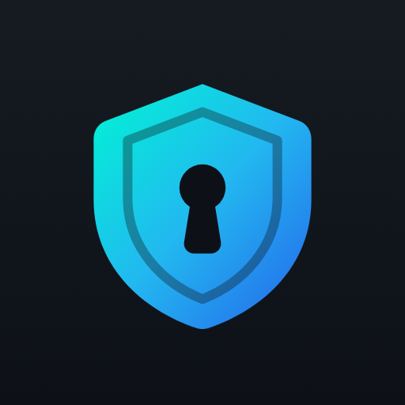
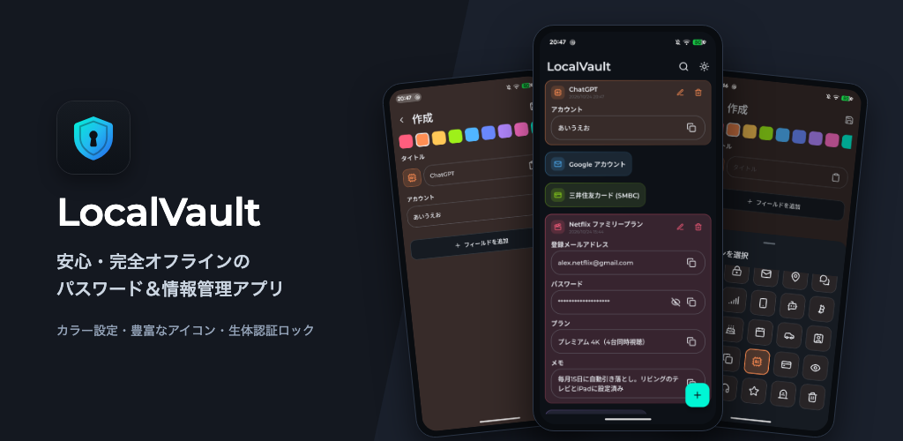
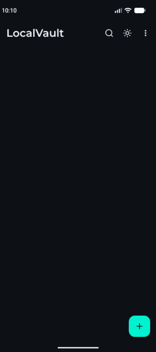

<div align="center">



# LocalVault

**完全オフライン・ハードウェア暗号化対応の Android 向けパスワード＆認証情報管理アプリ**

[](https://kotlinlang.org/)
[](https://developer.android.com/jetpack/compose)
[-3DDC84?style=flat&logo=android&logoColor=white)](https://www.android.com/)
[](https://developer.android.com/topic/architecture)
[-16A34A?style=flat)](app/src/main/AndroidManifest.xml)
[](LICENSE)

<br />

<a href="https://play.google.com/store/apps/details?id=com.lihan.localvault">
  
</a>

<br /><br />

[English](README.md) &nbsp;|&nbsp; [繁體中文](README.zh-TW.md) &nbsp;|&nbsp; **日本語**

</div>

---

<p align="center">
  
</p>

## 概要

**LocalVault** は、プライバシーとセキュリティを最優先に設計された **完全オフライン・ゼロネットワーク権限** の Android 向けパスワード、認証情報、暗号化ファイル管理アプリです。クラウド型のパスワードマネージャーとは異なり、`AndroidManifest.xml` に `INTERNET` 権限を一切宣言していません。すべてのデータと添付ファイルは端末内にのみ保存され、**Android KeyStore** によるハードウェア保護 **AES-256-GCM** 暗号化と **BiometricPrompt** 生体認証で厳重に守られます。

---

## 操作デモ

<p align="center">
  
</p>

---

## スクリーンショット

| 保管庫一覧 | 詳細表示 | 作成・編集 | アイコン＆カラー設定 | インスタント検索 |
| :---: | :---: | :---: | :---: | :---: |
|  |  |  |  |  |

---

## 主な機能

- **完全オフライン＆ゼロテレメトリ** — `android.permission.INTERNET` 権限を持たず、`android:allowBackup="false"` を設定。トラッカーやクラウド漏洩のリスクを根本から排除します。
- **ハードウェア保護 AES-256-GCM 暗号化** — **Android KeyStore** 内でマスターキーを生成・管理し、暗号化ごとに固有のランダム IV と 128-bit GCM 認証タグを付与します。
- **生体認証＆画面ロック解除** — AndroidX `BiometricPrompt` により、指紋認証・顔認証および端末の PIN／パターン／パスワード認証に対応。
- **柔軟なカスタムフィールド** — 保管庫ごとに必要な項目を自由に組み合わせ・名前変更できます：
  - **1行テキスト**：ユーザー名、メールアドレス、URL、会員 ID など。
  - **パスワード／PIN**：デフォルトでマスク表示。表示切り替えとワンタップコピーに対応。
  - **複数行メモ**：リカバリーコード、シードフレーズ、ライセンスキーなどの自由メモ。
- **暗号化ファイル＆画像添付** — 写真・画像・ドキュメントを暗号化してローカル保存。スマート画像圧縮、アプリ内暗号化プレビュー、削除時の自動ファイルクリーンアップを備えています。
- **暗号化ローカルバックアップ＆復元** — ユーザー設定のパスフレーズから鍵を導出（`PBKDF2WithHmacSHA256` 100,000 回反復 + `AES-256-GCM`）し、暗号化バックアップのエクスポート・復元が可能。添付ファイルを含めるかも選択できます。
- **遅延復号アーキテクチャ（Lazy Decryption）** — 一覧では軽量なメタデータのみを読み込み、カードを展開した時だけ復号することで軽快な動作と安全性を両立します。
- **ビジュアルカスタマイズ＆Material 3** — カテゴリ別アイコン、カラーテーマ、即時インクリメンタル検索、ダーク／ライトモード切り替えに対応。

---

## セキュリティ設計

| レイヤー | 実装方式 |
| :--- | :--- |
| **データ暗号化** | `AndroidKeyStoreCryptoManager` — `AES/GCM/NoPadding`（256-bit ハードウェア保護鍵、ランダム IV） |
| **添付ファイル保護** | `AndroidEncryptedFileManager` — AndroidX Security Crypto 暗号化ストレージ＋ライフサイクル削除管理 |
| **バックアップ／復元** | `BackupCryptoManager` — `PBKDF2WithHmacSHA256`（100,000 回反復、16-byte ランダムソルト）+ `AES-256-GCM` |
| **認証** | AndroidX `BiometricPrompt`（生体認証・端末ロック）+ `SessionManager` |
| **ネットワーク分離** | `AndroidManifest.xml` から `android.permission.INTERNET` を意図的に除外 |
| **クラウドバックアップ無効化** | `android:allowBackup="false"` によりシステム自動バックアップを防止 |

---

## 技術スタック＆アーキテクチャ

本プロジェクトは **Clean Architecture** と **MVI（Model-View-Intent）** 単方向データフローを採用しています。

| カテゴリ | 採用技術 |
| :--- | :--- |
| **言語** | Kotlin `2.2.10` |
| **UI** | Jetpack Compose（BOM `2026.02.01`）、Material 3 |
| **ナビゲーション** | Jetpack Navigation Compose `2.8.8`（型安全ルート） |
| **DI** | Koin `4.0.2`（`koin-android`、`koin-androidx-compose`） |
| **データベース** | Room `2.8.4`（SQLite + KSP + スキーママイグレーション） |
| **設定保存** | Jetpack DataStore Preferences `1.2.1` |
| **セキュリティ** | Android KeyStore、AndroidX Biometric、AndroidX Security Crypto |
| **画像・メディア** | Coil Compose `2.7.0`、AndroidX ExifInterface |
| **非同期・シリアライズ** | Kotlin Coroutines `1.10.1`、Flow、Kotlinx Serialization JSON `1.8.0` |

---

## プロジェクト構成

```text
app/src/main/java/com/lihan/localvault/
├── core/
│   ├── data/
│   │   ├── datastore/          # テーマ＆アプリ設定（DataStore）
│   │   └── security/
│   │       ├── crypto/         # AndroidKeyStoreCryptoManager（AES-256-GCM）
│   │       └── storage/        # AndroidEncryptedFileManager（暗号化添付管理）
│   ├── database/               # Room AppDatabase、DAO、Entities、DTOs、Mappers
│   ├── di/                     # CoreModule（Koin）
│   ├── domain/
│   │   ├── security/           # CryptoManager、BackupCryptoManager、EncryptedFileManager
│   │   └── session/            # SessionManager
│   └── presentation/           # テーマ、アイコン、BiometricPromptManager、EncryptedImageView
├── feature/
│   └── vault/
│       ├── data/               # VaultRepositoryImpl
│       ├── di/                 # VaultModule（Koin）
│       ├── domain/             # VaultRepository
│       └── presentation/
│           ├── vault/          # 保管庫一覧、検索、展開、バックアップ／復元（MVI）
│           └── create/         # 保管庫作成・編集、フィールド、添付、アイコン＆カラー選択（MVI）
└── navigation/                 # NavigationRoot および型安全 Route 定義
```

---

## ビルドと実行方法

### 前提条件

- **Android Studio** Ladybug 以降
- **JDK** 17 または 21
- **Android SDK** 37（`compileSdk = 37`、`minSdk = 24`）

### ビルド手順

```bash
# リポジトリをクローン
git clone https://github.com/encorex32268/LocalVault.git
cd LocalVault

# ユニットテストを実行
./gradlew testDebugUnitTest

# Debug APK をビルド
./gradlew assembleDebug

# 接続端末またはエミュレーターへインストール
./gradlew installDebug
```

---

## ライセンス

本プロジェクトは **GNU General Public License v3.0（GPL-3.0）** ライセンスのもとで公開されています。詳細は [LICENSE](LICENSE) ファイルをご確認ください。
