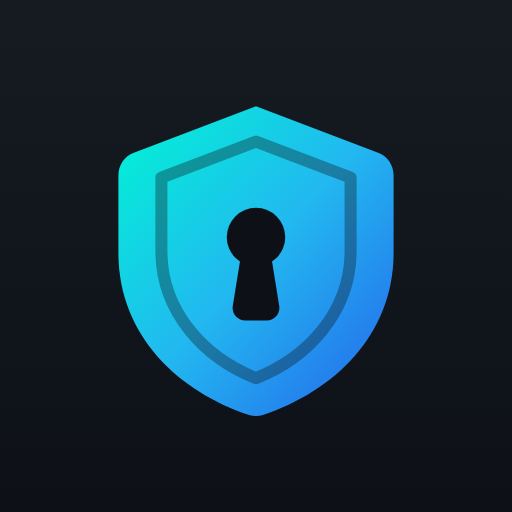
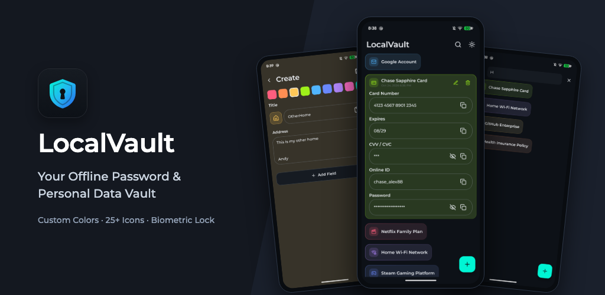
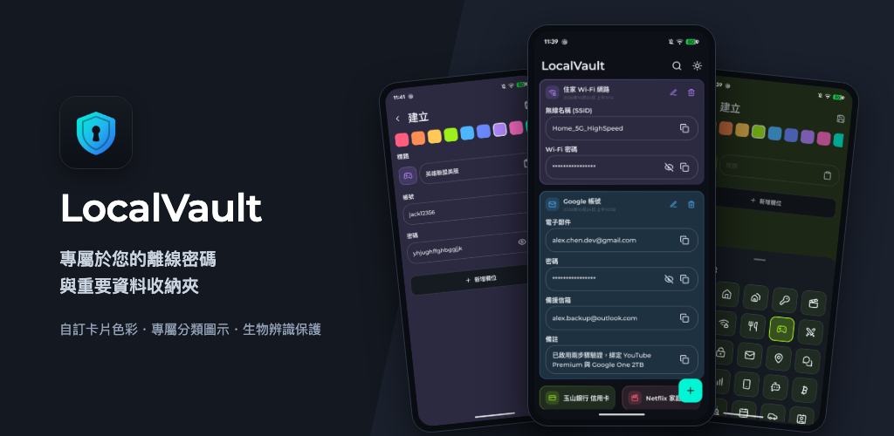
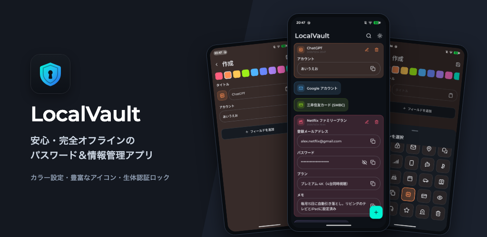

<div align="center">



# LocalVault

**Secure • Offline-First • Zero Network • Biometric Protected**

An open-source, local-first credential and password manager for Android built with modern Jetpack Compose and hardware-backed AES-256-GCM encryption.

<p>
  <a href="#-english"><b>English</b></a> •
  <a href="#-繁體中文"><b>繁體中文</b></a> •
  <a href="#-日本語"><b>日本語</b></a>
</p>

[](https://www.android.com/)
[](https://kotlinlang.org/)
[](https://developer.android.com/jetpack/compose)
[](https://developer.android.com/about/versions/nougat)
[](https://developer.android.com/reference/android/security/keystore/KeyGenParameterSpec)
[](#)

</div>

---

## 🌐 Language Navigation / 語言切換 / 言語切換

- [🇺🇸 English](#-english)
- [🇹🇼 繁體中文](#-繁體中文)
- [🇯🇵 日本語](#-日本語)

---

## 🇺🇸 English

<p align="center">
  
</p>

### Overview

**LocalVault** is a privacy-first, 100% offline password and credential manager for Android. Unlike traditional password managers that store your confidential data on third-party cloud servers, LocalVault never connects to the internet. Your sensitive data stays strictly on your physical device, protected by the **Android KeyStore** and encrypted with **AES-256-GCM**.

### 📱 Screenshots

| 1. Vault List | 2. Item Details | 3. Create / Edit | 4. Custom Icon & Color | 5. Instant Search |
| :---: | :---: | :---: | :---: | :---: |
|  |  |  |  |  |

### ✨ Key Features

- 🚫 **100% Offline & Zero Network Permission**: No `android.permission.INTERNET` requested. No analytics, no tracking, and zero attack surface from network vulnerabilities.
- 🔐 **Hardware-Backed AES-256-GCM Encryption**: All sensitive payloads are encrypted via `AndroidKeyStoreCryptoManager` using hardware-backed Android KeyStore keys and authenticated AES-GCM cipher with random IVs.
- 👆 **Biometric & Device Credential Authentication**: Unlock vault details with fingerprint, face unlock, or system PIN/pattern/password using Android's `BiometricPrompt`.
- 🧩 **Customizable Dynamic Fields**:
  - **Single-line Text**: Usernames, email addresses, websites, or IDs.
  - **Password / PIN**: Masked values with toggleable visibility and one-tap clipboard copy.
  - **Multi-line Notes**: Private notes, recovery seeds, recovery codes, or addresses.
  - **Editable Labels**: Rename field titles on the fly.
- 🎨 **Visual Personalization**: Choose from a collection of curated category icons and accent colors for quick recognition.
- 🔍 **Instant Search**: Rapidly filter your vaults by title in real-time.
- 🌓 **Material 3 Theming**: Seamless dark and light mode toggle adhering to Material You principles.
- ⚡ **Lazy Decryption Architecture**: List summaries are loaded efficiently without decrypting payload data until explicitly accessed.

### 🛠️ Architecture & Tech Stack

LocalVault is built following **Clean Architecture** and the **MVI (Model-View-Intent)** presentation pattern:

- **Language**: Kotlin 2.0+
- **UI Framework**: Jetpack Compose (Material 3)
- **Local Database**: Room Database (SQLite)
- **Security & Keystore**: Android KeyStore (`AES/GCM/NoPadding`, 256-bit key size)
- **Authentication**: AndroidX Biometric (`BiometricPrompt`)
- **Dependency Injection**: Koin (`koin-android`, `koin-androidx-compose`)
- **Preferences**: Jetpack DataStore Preferences
- **Asynchronous / Stream**: Kotlin Coroutines & Flow
- **Serialization**: Kotlinx Serialization JSON
- **System**: AndroidX Core SplashScreen API

### 🚀 Getting Started

#### Prerequisites
- Android Studio Ladybug (2024.2.1) or newer
- JDK 17 or JDK 21
- Android SDK 37 (Compile SDK 37, Min SDK 24)

#### Build and Run
```bash
# Clone the repository
git clone https://github.com/your-username/LocalVault.git
cd LocalVault

# Build the debug APK
./gradlew assembleDebug

# Install on a connected device / emulator
./gradlew installDebug
```

[Back to Top ↑](#localvault)

---

## 🇹🇼 繁體中文

<p align="center">
  
</p>

### 專案簡介

**LocalVault** 是一款專為注重隱私與安全性打造的 **100% 純本機、零網路連線** Android 密碼與敏感憑證管理工具。有別於將使用者機密資料託管於第三方雲端伺服器的密碼管理庫，LocalVault 連 `INTERNET` 網路權限都不申請，所有資料皆完整留存於您的實體裝置中，並由 **Android KeyStore** 硬體安全模組結合 **AES-256-GCM** 高強度加密守護。

### 📱 應用程式截圖

| 1. 保險庫清單 | 2. 展開詳細資訊 | 3. 新增與編輯 | 4. 自訂圖示與色彩 | 5. 即時快速搜尋 |
| :---: | :---: | :---: | :---: | :---: |
|  |  |  |  |  |

### ✨ 核心特色

- 🚫 **100% 離線 & 零網路權限**：完全未在 `AndroidManifest.xml` 中宣告 `android.permission.INTERNET`，無後門、無追蹤統計代碼，徹底阻斷來自網路的資料外洩與攻擊風險。
- 🔐 **硬體級 AES-256-GCM 加密**：透過 `AndroidKeyStoreCryptoManager` 調用 Android 系統安全模組產生主金鑰，並使用具備驗證標籤（Auth Tag）與動態隨機 IV 的 AES-256-GCM 演算法對機密資料進行加解密。
- 👆 **生物辨識與裝置密碼防護**：整合 AndroidX `BiometricPrompt`，支援指紋辨識、人臉解鎖，或以系統 PIN 碼／圖形密碼作為安全憑證驗證。
- 🧩 **高彈性自訂欄位**：
  - **單行文字欄位**：帳號、電子郵件、會員編號、網址等。
  - **密碼／PIN 欄位**：預設遮罩隱藏防窺探，支援點擊眼睛切換可見性與一鍵快速複製。
  - **多行文字備忘**：助記詞、備援金鑰、重要地址或備忘筆記。
  - **自訂欄位名稱**：自由修改每個欄位的標題。
- 🎨 **個性化卡片與視覺識別**：提供豐富精選的類別圖示與主題色彩標籤，便於分類管理與視覺化辨識。
- 🔍 **即時搜尋過濾**：輸入關鍵字即刻篩選標題，毫秒級快速找到指定項目。
- 🌓 **Material 3 深淺主題**：遵循最新 Material You 設計規範，支援深色模式與淺色模式切換。
- ⚡ **延遲解密架構（Lazy Decryption）**：保險庫清單僅讀取摘要資料，當且僅當使用者展開或主動檢視詳細內容時才進行解密，極致兼顧流暢度與安全性。

### 🛠️ 技術架構與技術棧

專案遵循現代化 **Clean Architecture** 與 **MVI (Model-View-Intent)** 架構模式：

- **開發語言**：Kotlin 2.0+
- **使用者介面**：Jetpack Compose (Material 3)
- **本機資料庫**：Room Database (SQLite)
- **安全與加密**：Android KeyStore (`AES/GCM/NoPadding`, 256 位元金鑰)
- **生物辨識**：AndroidX Biometric (`BiometricPrompt`)
- **依賴注入**：Koin (`koin-android`, `koin-androidx-compose`)
- **偏好設定**：Jetpack DataStore Preferences
- **非同步與串流**：Kotlin Coroutines & Flow
- **序列化工具**：Kotlinx Serialization JSON
- **啟動體驗**：AndroidX Core SplashScreen API

### 🚀 快速開始

#### 環境需求
- Android Studio Ladybug (2024.2.1) 或更高版本
- JDK 17 或 JDK 21
- Android SDK 37 (Compile SDK 37, Min SDK 24)

#### 編譯與安裝
```bash
# 複製專案
git clone https://github.com/your-username/LocalVault.git
cd LocalVault

# 編譯 Debug APK
./gradlew assembleDebug

# 安裝至連線的 Android 裝置或模擬器
./gradlew installDebug
```

[Back to Top ↑](#localvault)

---

## 🇯🇵 日本語

<p align="center">
  
</p>

### 概要

**LocalVault** は、プライバシーとセキュリティを最優先に設計された **完全オフライン・ゼロネットワーク権限** の Android 向けパスワード＆認証情報管理アプリです。機密データをサードパーティのクラウドサーバーに送信する従来のパスワードマネージャーとは異なり、LocalVault はインターネット権限を一切使用しません。すべてのデータはご自身の端末内にのみ保存され、**Android KeyStore** と **AES-256-GCM** による強力なハードウェア暗号化で安全に保護されます。

### 📱 スクリーンショット

| 1. 保管庫一覧 | 2. 詳細表示 | 3. 作成・編集 | 4. アイコン＆カラー設定 | 5. インスタント検索 |
| :---: | :---: | :---: | :---: | :---: |
|  |  |  |  |  |

### ✨ 主な機能

- 🚫 **完全オフライン＆インターネット権限ゼロ**：`AndroidManifest.xml` で `android.permission.INTERNET` を一切要求しません。トラッカーやアナリティクス、クラウド漏洩のリスクを根本から排除します。
- 🔐 **ハードウェア保護による AES-256-GCM 暗号化**：`AndroidKeyStoreCryptoManager` により、Android のセキュアハードウェア内にマスターキーを生成・保管。改ざん検知機能付きの AES-256-GCM（ランダム IV）で安全に暗号化します。
- 👆 **生体認証＆画面ロックによる保護**：`BiometricPrompt` に対応し、指紋認証、顔認証、または端末の PIN・パターン・パスワードによるスムーズな本人確認が可能です。
- 🧩 **自由度の高いカスタムフィールド**：
  - **1行テキスト**：ユーザー名、メールアドレス、URL、ID など。
  - **パスワード／PIN**：マスク表示による覗き見防止、表示切り替え、ワンタップでのクリップボードコピーに対応。
  - **複数行テキスト（メモ）**：シードフレーズ、リカバリーコード、自由なメモ内容。
  - **項目名の自由変更**：各フィールドのタイトルを必要に応じて自由に設定可能。
- 🎨 **ビジュアルカスタマイズ**：豊富なカテゴリ別アイコンとアクセントカラーから自由に選択し、視認性を高めます。
- 🔍 **高速インクリメンタル検索**：タイトル入力で即座に絞り込み検索が可能。
- 🌓 **Material 3 ダーク＆ライトテーマ**：最新の Material You に準拠し、ダークモードとライトモードを快適に切り替えられます。
- ⚡ **遅延復号アーキテクチャ（Lazy Decryption）**：一覧画面ではサマリー情報のみを高速に読み込み、ユーザーがカードを展開した時のみ詳細データを復号するため、軽快な動作と安全性を両立しています。

### 🛠️ アーキテクチャと技術スタック

本プロジェクトは **Clean Architecture** と **MVI (Model-View-Intent)** パターンを採用しています：

- **開発言語**：Kotlin 2.0+
- **UI フレームワーク**：Jetpack Compose (Material 3)
- **ローカルデータベース**：Room Database (SQLite)
- **セキュリティ・暗号化**：Android KeyStore (`AES/GCM/NoPadding`, 256-bit キー)
- **認証**：AndroidX Biometric (`BiometricPrompt`)
- **依存性注入**：Koin (`koin-android`, `koin-androidx-compose`)
- **環境設定・設定保存**：Jetpack DataStore Preferences
- **非同期・ストリーム**：Kotlin Coroutines & Flow
- **シリアライズ**：Kotlinx Serialization JSON
- **スプラッシュ画面**：AndroidX Core SplashScreen API

### 🚀 ビルドと実行方法

#### 前提条件
- Android Studio Ladybug (2024.2.1) 以降
- JDK 17 または JDK 21
- Android SDK 37 (Compile SDK 37, Min SDK 24)

#### ビルド手順
```bash
# リポジトリのクローン
git clone https://github.com/your-username/LocalVault.git
cd LocalVault

# Debug APK のビルド
./gradlew assembleDebug

# 接続端末またはエミュレーターへインストール
./gradlew installDebug
```

[Back to Top ↑](#localvault)

---

## 📄 License

This project is open-source. Please check the repository for license terms.
