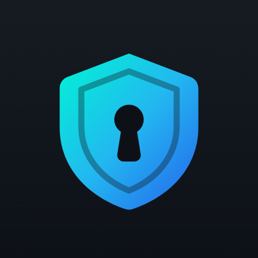

<div align="center">



# LocalVault (繁體中文)

**安全 • 完全離線 • 零網路權限 • 生物辨識防護**

專為注重隱私打造的開源 Android 本地密碼與敏感憑證管理工具，採用現代化 Jetpack Compose 與 AndroidKeyStore 硬體級 AES-256-GCM 加密技術。

<p>
  <a href="README.md"><b>English</b></a> •
  <a href="README.zh-TW.md"><b>繁體中文</b></a> •
  <a href="README.ja.md"><b>日本語</b></a>
</p>

[](https://www.android.com/)
[](https://kotlinlang.org/)
[](https://developer.android.com/jetpack/compose)
[](https://developer.android.com/about/versions/nougat)
[](https://developer.android.com/reference/android/security/keystore/KeyGenParameterSpec)
[](#)

</div>

---

<p align="center">
  
</p>

### 專案簡介

**LocalVault** 是一款專為注重隱私與安全性打造的 **100% 純本機、零網路連線** Android 密碼與敏感憑證管理工具。有別於將使用者機密資料託管於第三方雲端伺服器的密碼管理庫，LocalVault 完全不申請 `INTERNET` 網路權限，所有資料皆完整留存於您的實體裝置中，並由 **Android KeyStore** 硬體安全模組結合 **AES-256-GCM** 高強度加密守護。

### 📱 應用程式截圖

| 1. 保險庫清單 | 2. 展開詳細資訊 | 3. 新增與編輯 | 4. 自訂圖示與色彩 | 5. 即時快速搜尋 |
| :---: | :---: | :---: | :---: | :---: |
|  |  |  |  |  |

### ✨ 核心特色

- 🚫 **100% 離線 & 零網路權限**：完全未在 `AndroidManifest.xml` 中宣告 `android.permission.INTERNET`，無後門、無追蹤統計代碼，徹底阻斷來自網路的資料外洩與攻擊風險。
- 🔐 **硬體級 AES-256-GCM 加密**：透過 `AndroidKeyStoreCryptoManager` 調用 Android 系統安全模組產生主金鑰，並使用具備驗證標籤（Auth Tag）與動態隨機 IV 的 AES-256-GCM 演算法對機密資料進行加解密。
- 👆 **生物辨識與裝置密碼防護**：整合 AndroidX `BiometricPrompt`，支援指紋辨識、人臉解鎖，或以系統 PIN 碼／圖形密碼作為安全憑證驗證。
- 🧩 **高彈性自訂欄位**：
  - **單行文字欄位**：帳號、電子郵件、會員編號、網址等。
  - **密碼／PIN 欄位**：預設遮罩隱藏防窺探，支援點擊眼睛切換可見性與一鍵快速複製。
  - **多行文字備忘**：助記詞、備援金鑰、重要地址或備忘筆記。
  - **自訂欄位名稱**：自由修改每個欄位的標題。
- 🎨 **個性化卡片與視覺識別**：提供豐富精選的類別圖示與主題色彩標籤，便於分類管理與視覺化辨識。
- 🔍 **即時搜尋過濾**：輸入關鍵字即刻篩選標題，毫秒級快速找到指定項目。
- 🌓 **Material 3 深淺主題**：遵循最新 Material You 設計規範，支援深色模式與淺色模式切換。
- ⚡ **延遲解密架構（Lazy Decryption）**：保險庫清單僅讀取摘要資料，當且僅當使用者展開或主動檢視詳細內容時才進行解密，極致兼顧流暢度與安全性。

### 🛠️ 技術架構與技術棧

專案遵循現代化 **Clean Architecture** 與 **MVI (Model-View-Intent)** 架構模式：

- **開發語言**：Kotlin 2.0+
- **使用者介面**：Jetpack Compose (Material 3)
- **本機資料庫**：Room Database (SQLite)
- **安全與加密**：Android KeyStore (`AES/GCM/NoPadding`, 256 位元金鑰)
- **生物辨識**：AndroidX Biometric (`BiometricPrompt`)
- **依賴注入**：Koin (`koin-android`, `koin-androidx-compose`)
- **偏好設定**：Jetpack DataStore Preferences
- **非同步與串流**：Kotlin Coroutines & Flow
- **序列化工具**：Kotlinx Serialization JSON
- **啟動體驗**：AndroidX Core SplashScreen API

### 🚀 快速開始

#### 環境需求
- Android Studio Ladybug (2024.2.1) 或更高版本
- JDK 17 或 JDK 21
- Android SDK 37 (Compile SDK 37, Min SDK 24)

#### 編譯與安裝
```bash
# 複製專案
git clone https://github.com/your-username/LocalVault.git
cd LocalVault

# 編譯 Debug APK
./gradlew assembleDebug

# 安裝至連線的 Android 裝置或模擬器
./gradlew installDebug
```

---

## 📄 授權條款

本專案採開源釋出，授權條款請參閱本專案說明。
