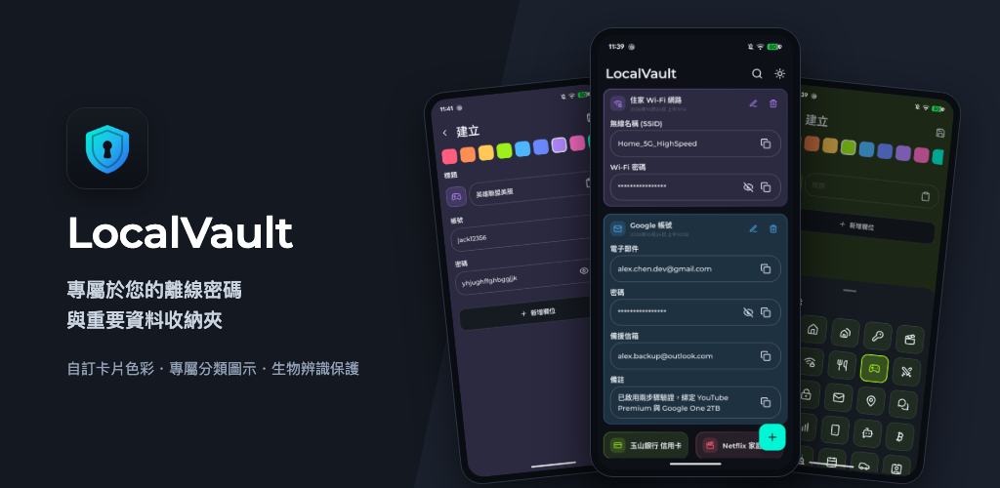

<div align="center">


# LocalVault

**100% 離線・硬體級加密的 Android 密碼與憑證管理工具**

[](https://kotlinlang.org/)
[](https://developer.android.com/jetpack/compose)
[-3DDC84?style=flat&logo=android&logoColor=white)](https://www.android.com/)
[](https://developer.android.com/topic/architecture)
[-16A34A?style=flat)](app/src/main/AndroidManifest.xml)
[](LICENSE)

<br />

<a href="https://play.google.com/store/apps/details?id=com.lihan.localvault">
  
</a>

<br /><br />

[English](README.md) &nbsp;|&nbsp; **繁體中文** &nbsp;|&nbsp; [日本語](README.ja.md)

</div>

---

<p align="center">
  
</p>

## 專案簡介

**LocalVault** 是一款專為重視隱私與安全性打造的 **100% 純本機、零網路連線** Android 密碼、憑證與私密附件管理工具。有別於將機密資料託管於第三方雲端的密碼管理員，LocalVault 在 `AndroidManifest.xml` 中完全不申請 `INTERNET` 網路權限。所有資料與附件皆嚴格留存於您的實體裝置內，並由 **Android KeyStore** 硬體級 **AES-256-GCM** 加密與 **BiometricPrompt** 生物辨識雙重防護。

---

## 操作示範

<p align="center">
  
</p>

---

## 應用程式截圖

| 保險庫清單 | 展開詳細資訊 | 新增與編輯 | 自訂圖示與色彩 | 即時快速搜尋 |
| :---: | :---: | :---: | :---: | :---: |
|  |  |  |  |  |

---

## 核心特色

- **100% 離線與零遙測** — 未宣告 `android.permission.INTERNET` 權限，且停用系統自動雲端備份（`android:allowBackup="false"`），無任何追蹤或分析 SDK，徹底杜絕網路外洩風險。
- **硬體級 AES-256-GCM 加密** — 透過 **Android KeyStore** 產生並保護主金鑰，每次加密皆使用獨立隨機 IV 與 128-bit GCM 驗證標籤，確保機密性與資料完整性。
- **生物辨識與裝置憑證解鎖** — 整合 AndroidX `BiometricPrompt`，支援指紋、人臉辨識及裝置 PIN／圖形／密碼驗證，搭配 Session 鎖定控管。
- **高彈性動態欄位** — 可依需求自由組合與命名每個保險庫的欄位：
  - **單行輸入**：帳號、電子郵件、網址、會員編號等。
  - **密碼／PIN**：預設遮罩隱藏，支援切換明文顯示與一鍵複製至剪貼簿。
  - **多行文字備忘**：復原碼、助記詞、授權序號或私密筆記。
- **加密圖片與檔案附件** — 支援附加圖片與文件，檔案於本機加密儲存，並具備智慧圖片壓縮、App 內加密預覽視窗，以及刪除項目時自動清理實體加密檔案的生命週期管理。
- **加密本機備份與還原** — 透過使用者自訂密碼衍生金鑰（`PBKDF2WithHmacSHA256` 100,000 次迭代 + `AES-256-GCM`）匯出與還原加密備份檔，並可自由選擇是否一併包含加密附件。
- **延遲解密架構（Lazy Decryption）** — 清單頁僅載入摘要資訊，直到使用者展開卡片時才即時解密內容，兼顧效能與安全。
- **視覺化分類與 Material 3 主題** — 內建精選分類圖示與卡片色彩主題、即時關鍵字搜尋，以及深色／淺色模式流暢切換。

---

## 安全架構一覽

| 防護層級 | 實作機制 |
| :--- | :--- |
| **資料內容加密** | `AndroidKeyStoreCryptoManager` — `AES/GCM/NoPadding`（256-bit 硬體保護金鑰、隨機 IV） |
| **加密附件儲存** | `AndroidEncryptedFileManager` — AndroidX Security Crypto 本機加密儲存與自動清理 |
| **備份與還原加密** | `BackupCryptoManager` — `PBKDF2WithHmacSHA256`（100,000 次迭代、16-byte 隨機鹽值）+ `AES-256-GCM` |
| **身分驗證** | AndroidX `BiometricPrompt`（生物辨識與裝置密碼）+ `SessionManager` |
| **網路隔離** | `AndroidManifest.xml` 完全未宣告 `android.permission.INTERNET` |
| **停用雲端備份** | `android:allowBackup="false"` 防止系統將本機資料庫自動備份至雲端 |

---

## 技術棧與架構

本專案遵循 **Clean Architecture** 與 **MVI（Model-View-Intent）** 單向資料流架構。

| 類別 | 技術與套件 |
| :--- | :--- |
| **開發語言** | Kotlin `2.2.10` |
| **使用者介面** | Jetpack Compose（BOM `2026.02.01`）、Material 3 |
| **導航** | Jetpack Navigation Compose `2.8.8`（型別安全路由） |
| **依賴注入** | Koin `4.0.2`（`koin-android`、`koin-androidx-compose`） |
| **本機資料庫** | Room `2.8.4`（SQLite + KSP + Schema Migration） |
| **偏好設定** | Jetpack DataStore Preferences `1.2.1` |
| **安全與加密** | Android KeyStore、AndroidX Biometric、AndroidX Security Crypto |
| **圖片與媒體** | Coil Compose `2.7.0`、AndroidX ExifInterface |
| **非同步與序列化** | Kotlin Coroutines `1.10.1`、Flow、Kotlinx Serialization JSON `1.8.0` |

---

## 專案結構

```text
app/src/main/java/com/lihan/localvault/
├── core/
│   ├── data/
│   │   ├── datastore/          # 主題與應用程式偏好設定（DataStore）
│   │   └── security/
│   │       ├── crypto/         # AndroidKeyStoreCryptoManager（AES-256-GCM）
│   │       └── storage/        # AndroidEncryptedFileManager（加密附件儲存）
│   ├── database/               # Room AppDatabase、DAO、Entities、DTOs、Mappers
│   ├── di/                     # CoreModule（Koin）
│   ├── domain/
│   │   ├── security/           # CryptoManager、BackupCryptoManager、EncryptedFileManager
│   │   └── session/            # SessionManager
│   └── presentation/           # 主題、圖示、BiometricPromptManager、EncryptedImageView
├── feature/
│   └── vault/
│       ├── data/               # VaultRepositoryImpl
│       ├── di/                 # VaultModule（Koin）
│       ├── domain/             # VaultRepository
│       └── presentation/
│           ├── vault/          # 保險庫清單、搜尋、展開、備份與還原（MVI）
│           └── create/         # 新增／編輯保險庫、欄位、附件、圖示與色彩選擇（MVI）
└── navigation/                 # NavigationRoot 與型別安全 Route 定義
```

---

## 快速開始

### 環境需求

- **Android Studio** Ladybug 或更高版本
- **JDK** 17 或 21
- **Android SDK** 37（`compileSdk = 37`，`minSdk = 24`）

### 編譯與執行

```bash
# 複製專案
git clone https://github.com/encorex32268/LocalVault.git
cd LocalVault

# 執行單元測試
./gradlew testDebugUnitTest

# 編譯 Debug APK
./gradlew assembleDebug

# 安裝至連線的 Android 裝置或模擬器
./gradlew installDebug
```

---

## 授權條款

本專案採用 **GNU General Public License v3.0（GPL-3.0）** 開源授權，詳情請參閱 [LICENSE](LICENSE) 檔案。
